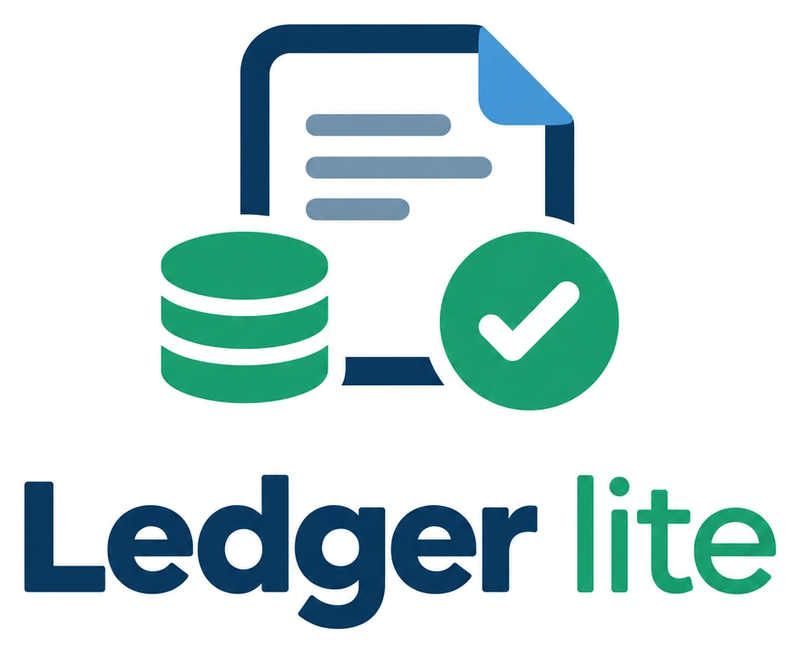

<p align="center"></p>

# LedgerLite

LedgerLite is a small bookkeeping app for a UK limited company with one or two people in it. I built it to stop paying for QuickBooks.

My company raises four or five invoices a month, is VAT registered, and has an accountant who runs payroll and files the returns. What I actually needed from QuickBooks was much narrower than what it does:

- send invoices and know which ones have been paid
- keep track of supplier bills and receipts
- explain every line on the bank statement, including the small automatic ones (PAYE, VAT, the odd client dinner) that are easy to forget by year end
- hand the accountant a clean spreadsheet each VAT quarter and at year end

LedgerLite does those things and not much else. It runs on Cloudflare's free tier.

It is not accounting software in the regulated sense: it doesn't file anything with HMRC, run payroll or give advice. Your accountant still does that part.

## What it does

- **Invoices.** Line items with VAT, PDFs with your logo and bank details, part payments, voiding.
- **Import from QuickBooks.** Past invoices from a QuickBooks Online export (CSV or Excel) keep their original numbers, customers and paid or outstanding status. You can attach the original PDFs, and new invoices carry on the old numbering.
- **Bills.** Supplier bills with a category per line and the PDF attached.
- **Bank statements.** CSV import for Barclays, HSBC, Lloyds, NatWest, Monzo and Starling, with duplicate detection and a running-balance check.
- **Matching.** Bank lines are suggested against open invoices and bills. One payment can be split across several bank lines, and the result is posted in a single transaction.
- **Rules.** For example, "description contains HMRC VAT → VAT Payments". Rules run on every import, so recurring payments are categorised without anyone remembering to do it. Anything left over shows up in an "unexplained" list.
- **Accountant export.** One `.xlsx` per VAT quarter or any date range: every bank line with its category and explanation, plus invoices and bills, optionally zipped with the receipts.
- **Reports.** Profit and loss, outstanding invoices, aged debtors, cash flow, and a year-end ZIP per UK tax year.
- **Two roles.** The owner can do everything. The accountant can read, flag items, add notes and export, but can't change any figures. This is enforced by the API, not just hidden in the UI.

## How it is built

```
Browser ──► Cloudflare Pages (static site)
              │  /api/* and /auth/* forwarded over a service binding
              ▼
            Cloudflare Worker (API, no public address of its own)
              ├── D1  (SQLite database)
              └── R2  (PDFs, receipts, logo; private bucket)
```

| Part | Technology |
|---|---|
| API | Cloudflare Workers, Hono, TypeScript, Zod |
| Database | Cloudflare D1 (SQLite), plain SQL migrations |
| File storage | Cloudflare R2, only reachable through the API |
| Frontend | Next.js 16 static export, React 19, TanStack Query, React Hook Form, Tailwind CSS |
| PDF, ZIP and Excel | pdf-lib, fflate (with a small built-in `.xlsx` writer and reader) |
| Tests | Vitest with `@cloudflare/vitest-pool-workers`, running against a real local D1 |

Money is stored as whole pence everywhere and only turned into pounds for display. Totals are always recalculated on the server, never taken from the browser.

Because the site and the API are served from the same address, the sign-in cookie can be locked down (`SameSite=Strict`), and there is no cross-origin traffic to configure.

## Running it locally

You need Node.js 22 or later.

```bash
git clone https://github.com/csantiagu/LedgerLite.git
cd LedgerLite

# API, on http://localhost:8787
cd worker
npm install
cp .dev.vars.example .dev.vars        # fill in JWT_SECRET, API_KEY_SALT and ENCRYPTION_KEY
npx wrangler d1 migrations apply accounts-db --local
npm run dev -- --port 8787

# Frontend, on http://localhost:3001 (in a second terminal)
cd frontend
npm install
npm run dev
```

Then open http://localhost:3001/setup, create the owner account, and fill in your company details and bank accounts.

To start again with an empty database, delete `worker/.wrangler/state` and apply the migrations again.

## Tests

```bash
cd worker
npm run typecheck
npm test
```

The worker tests cover unit logic (money, VAT periods, matching, rules, two-factor codes) and the API end to end against a fresh local database with every migration applied. For the frontend, `npm run typecheck` and `npm run build` in `frontend/`. GitHub Actions runs all of these on every push.

## Deploying to Cloudflare

Everything fits in Cloudflare's free plan, and no domain of your own is needed. R2 has to be switched on once in the dashboard. It has a free allowance, but beyond that it bills, so it's the one part that could ever cost money.

1. Log in with `npx wrangler login` (from `worker/`).
2. Create the database and the bucket, put the database ID into `worker/wrangler.toml`, and apply the migrations:

   ```bash
   npx wrangler d1 create accounts-db --location weur
   npx wrangler r2 bucket create accounts-storage --location weur
   npm run migrate:remote
   ```

3. Create the Pages project. Its name becomes the address, e.g. `my-ledger.pages.dev`. Put the same name in `frontend/wrangler.toml`.

   ```bash
   npx wrangler pages project create my-ledger --production-branch main
   ```

4. Deploy the API and the site:

   ```bash
   npm run deploy
   ```

5. Set the secrets. The API refuses to run until they exist, and refuses ones that are too short:

   ```bash
   openssl rand -base64 32 | npx wrangler secret put JWT_SECRET
   openssl rand -base64 32 | npx wrangler secret put API_KEY_SALT
   openssl rand -base64 32 | npx wrangler secret put ENCRYPTION_KEY
   openssl rand -hex 16 | tee ~/ledgerlite-setup-token.txt | npx wrangler secret put SETUP_TOKEN
   printf https://my-ledger.pages.dev | npx wrangler secret put ALLOWED_ORIGIN
   ```

6. Open `/setup` on your site and create the owner account using the setup token. Then turn on two-factor sign-in under Security, delete the token file, and remove the secret with `npx wrangler secret delete SETUP_TOKEN`.

I'd also put Cloudflare Access in front of the site. It's free for up to 50 users. Create a self-hosted application under Zero Trust → Access for `my-ledger.pages.dev` and `*.my-ledger.pages.dev`, allowing only your own email address and your accountant's. Then nobody else can even reach the login page.

## Security

The app holds bank statements and company accounts, so sign-in is taken seriously:

- **Passwords** are hashed with PBKDF2-SHA256 at 100,000 iterations and need at least 12 characters.
- **Two-factor sign-in** works with any authenticator app, with single-use recovery codes. The secrets are encrypted in the database.
- **Sessions** combine a short-lived access token kept only in memory with a refresh token in an `httpOnly`, `Secure`, `SameSite=Strict` cookie that is replaced on every use. If an old one is replayed, every session for that user is ended.
- **Revocation is immediate.** Changing a password, deactivating a user or choosing "sign out everywhere" takes effect on the next request.
- **Setup** needs a one-time token, so nobody else can claim a fresh deployment.
- **Uploads** are identified by their content (PDF, PNG, JPEG or WebP only) and always served back as sandboxed downloads.
- **Other protections:** rate limits on sign-in and the API, CSRF checks, and security headers (CSP, HSTS, no framing, no caching of API responses).

If you find a security problem, please open a private security advisory on GitHub rather than a public issue.

## Limitations

- **One company per deployment**, in pounds, with UK tax years and VAT quarters. For a second company, deploy a second copy; the data then stays completely separate.
- **No HMRC filing.** There's no Making Tax Digital submission and no payroll. The exports are meant for an accountant who does that.
- **Bank feeds are CSV only.** There's no Open Banking connection; you download statements from your bank and import them.
- **QuickBooks import covers invoices only**, as totals with the original PDF rather than rebuilt line items. QuickBooks' invoice list usually has no payment dates, so imported payments are dated on the invoice date.
- **Rate limits are approximate.** Cloudflare counts them per data centre, which is enough to slow down password guessing but isn't a hard quota.
- **Built for one company's needs.** It's been used and tested by one company. Check it fits yours before relying on it, and keep your accountant in the loop.

## Project layout

```
worker/              Cloudflare Worker: the API
  src/routes/        one file per area (invoices, bills, bank imports, reports, ...)
  src/services/      money, CSV parsing, matching, rules, PDF, xlsx, imports
  src/middleware/    sign-in, roles, CSRF, rate limiting, audit log
  migrations/        numbered D1 migrations
  test/              unit and integration tests
frontend/            Next.js app, exported as static files
  src/app/           pages
  src/lib/           API client, sign-in state, formatting, QuickBooks import parsing
  functions/         Pages functions that forward /api and /auth to the Worker
```

## Licence

[MIT](LICENSE). Use it, change it, and share it. It comes with no warranty.
